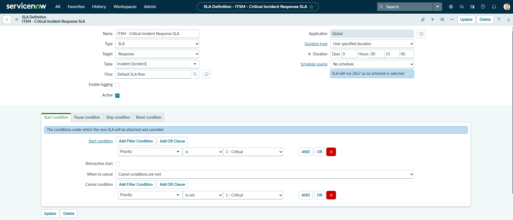
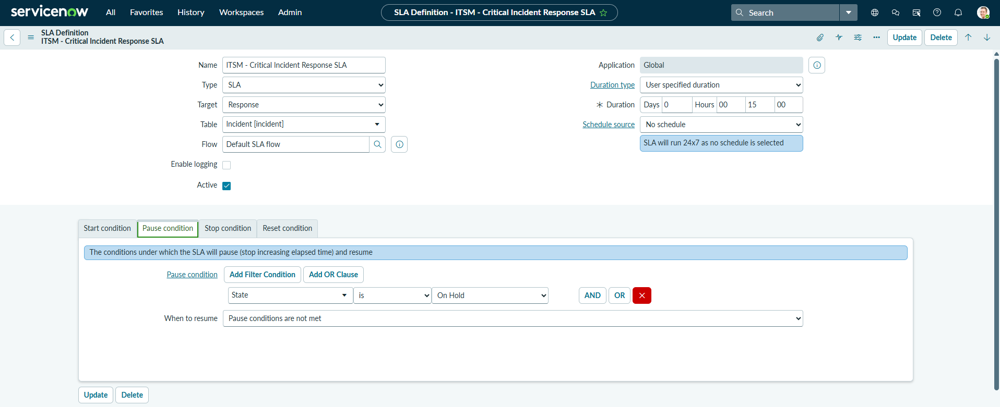
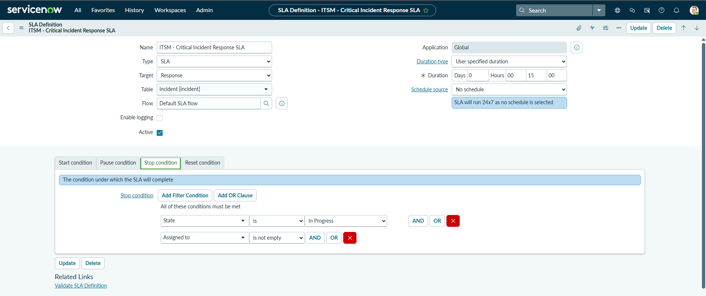
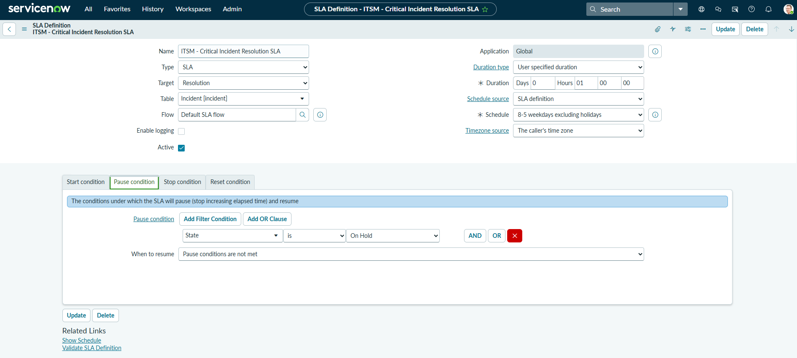
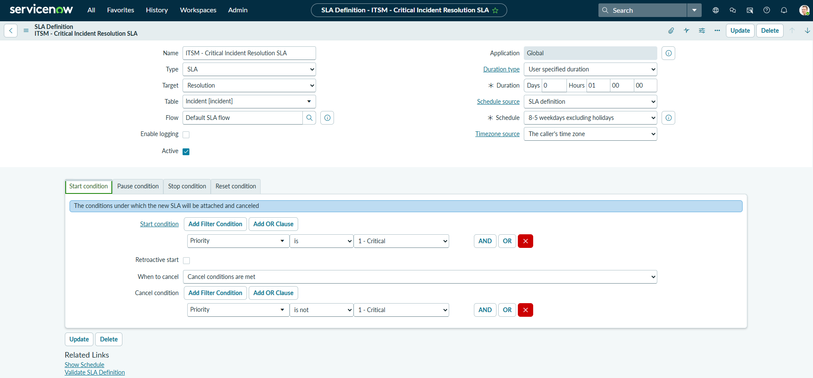
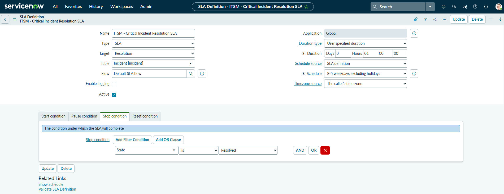
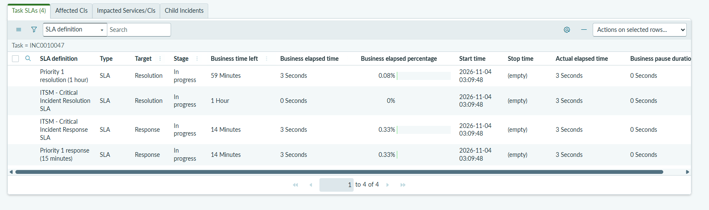
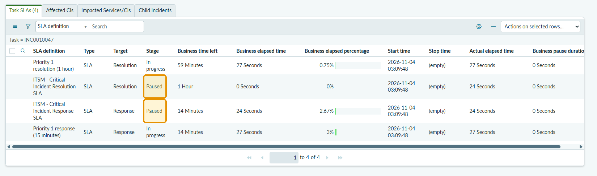
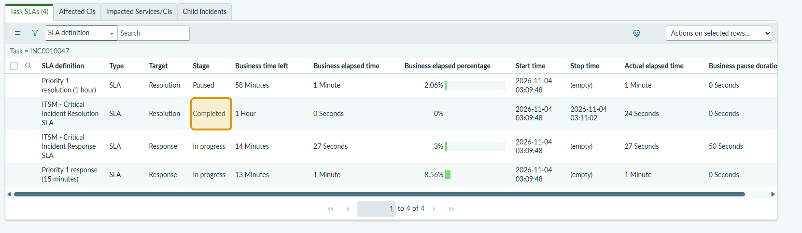

# ServiceNow - SLA Management

## Visão Geral do Projeto

Este projeto demonstra a configuração e o monitoramento de SLAs (Service Level Agreements) na plataforma ServiceNow.

O objetivo é acompanhar os prazos de atendimento e resolução de incidentes, permitindo que as equipes de suporte monitorem os níveis de serviço e controlem os tempos de resposta e resolução.

## Objetivos

- Configurar Response SLA e Resolution SLA.
- Definir condições de início, pausa e encerramento das SLAs.
- Monitorar os prazos de atendimento e resolução de incidentes.
- Acompanhar o tempo decorrido, tempo restante e percentual consumido.
- Testar o comportamento das SLAs durante o ciclo de vida de um incidente.

## Tecnologias e Recursos Utilizados

- ServiceNow Platform
- Incident Management
- SLA Definitions
- Task SLA
- ServiceNow Personal Developer Instance (PDI)

## Implementação

### 1. Response SLA

Configurada para monitorar o tempo necessário para que a equipe de suporte inicie o atendimento de um incidente.

### 2. Resolution SLA

Configurada para monitorar o tempo necessário para que um incidente seja resolvido.

### 3. Condições das SLAs

Configuração das condições de início, pausa e encerramento, de acordo com o ciclo de vida do incidente.

### 4. Monitoramento e Testes

Foi utilizado um cenário de teste com um incidente crítico para acompanhar o funcionamento das SLAs, monitorando:

- Tempo decorrido.
- Tempo restante.
- Percentual de SLA consumido.
- Conclusão da SLA após a resolução do incidente.

## Evidências do Projeto

### 1. Configuração — Response SLA

**Condição de início:**

**Condição de pausa:**

**Condição de encerramento:**

### 2. Configuração — Resolution SLA

**Condição de início:**

**Condição de pausa:**

**Condição de encerramento:**

### 3. Monitoramento do ciclo de vida do incidente

**Incidente em New:**

**Incidente em On Hold — SLAs pausadas:**

**Incidente em Resolved — SLA concluída:**

## Demonstração em Vídeo

Confira a demonstração prática do projeto no LinkedIn:

[Assistir à demonstração do projeto](https://lnkd.in/p/ddEx9_Nt)

## Aprendizados

Durante o desenvolvimento deste projeto, adquiri experiência prática com:

- Configuração de Service Level Agreements (SLAs).
- Gerenciamento do ciclo de vida de incidentes.
- Monitoramento dos tempos de atendimento e resolução.
- Configuração de condições de SLA.
- Testes e validação do comportamento das SLAs.

---

**Autor:** João Pedro Arruda

**Foco:** ServiceNow Development | ITSM | Automação

